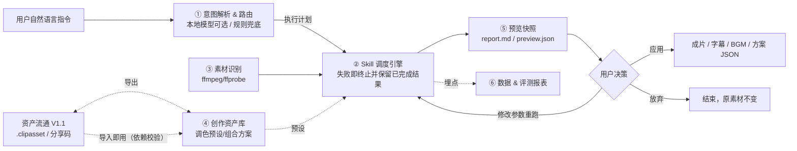

# 剪辑辅助 Agent · Clip Agent

面向**剪映 PC 专业版**创作者的 AI 剪辑辅助工具：接收自然语言指令 → 意图解析 → Skill 调度引擎自动编排 → 生成预览报告 → 创作者确认应用。

> **核心定位：AI 是创作者的助手，不是全自动剪辑替代。**
> 所有 AI 结果先预览、可修改参数重跑、可放弃，创作者拥有最终控制权。

## 功能总览

- **自然语言指令**：`识别视频静音片段并自动裁剪`、`批量校对所有字幕错别字，统一字体样式`、`筛选高光镜头，匹配BGM卡点`
- **6 个内置原子 Skill**（S001–S006）：独立封装、参数可配、可上下线，新增 Skill 不需要改调度核心；S006 语音转写为可选能力（需安装 `[asr]` 可选依赖）
- **创作资产库**：调色预设 / 字幕模板 / Skill 组合方案，支持检索、收藏、版本回滚
- **资产流通（V1.1）**：导出 `.clipasset` 分享文件 + 分享码 → 创作者社群分发 → 导入即用（依赖校验、幂等判重、参数变更自动升级版本）
- **资产发现（P2 本地先行版）**：`assets discover` 按质量分（去重素材复用 × 收藏 × 导入）排序资产广场，支持场景标签筛选与 `--html` 广场页；复用按「独立素材」去重，为社区榜单预留防刷口径
- **双形态预览报告**：Markdown（可版本控制）+ HTML（可视化，单文件可分享，无需服务器）
- **剪映草稿导出（V1.2）**：`export-jianying <run_dir>` 把一次运行的裁剪轨/字幕轨/BGM 轨写成剪映草稿，Mac/Linux 生成后在 Windows 版剪映打开导出；可选依赖 `[jianying]`，核心运行时仍零依赖
- **评测埋点**：Skill 调用链路、耗时、采纳/修改/放弃行为 → 效率/质量/生态指标报表（文本 + HTML 仪表盘）
- **本地优先**：意图路由支持 Ollama 等本地模型（OpenAI 兼容接口，可选）；未配置时自动降级为关键词规则路由，纯本地也能跑
- **零第三方依赖**：Python 标准库实现，仅依赖系统 `ffmpeg` / `ffprobe`

## 架构



## 快速开始

依赖：Python 3.9+、ffmpeg（含 ffprobe）。

```bash
brew install ffmpeg            # macOS；Windows 见 ffmpeg.org

python3 -m venv .venv && source .venv/bin/activate
pip install -e ".[dev]"

# 可选：本地语音转写（Apple Silicon + Python≥3.10 自动装 mlx-whisper，其他平台装 faster-whisper）
pip install -e ".[asr]"

python scripts/make_demo_fixture.py    # 生成演示素材（含静音的视频、带问题的字幕、BGM）
python scripts/make_speech_fixture.py  # 可选（macOS）：生成中文口播素材，用于演示语音转写

bash scripts/run_demo.sh               # 一键跑完 4 条核心演示链路 + 评测报表 + 资产广场
```

### 示例：一次完整调用

```bash
# 1) 静音片段裁切：预览报告 + 渲染成片
python -m clip_agent run "识别静音片段并裁剪" --media output/demo/demo.mp4 --yes

# 2) 字幕批量校对（标点/折行/时间轴重叠/重复 + 样式统一）
python -m clip_agent run "批量校对字幕错别字，统一样式" --subtitle output/demo/demo.srt --yes

# 3) 高光筛选 → BGM 对齐（多 Skill 串行编排，自动接力中间结果）
python -m clip_agent run "筛选高光镜头，匹配BGM卡点" \
    --media output/demo/demo.mp4 --bgm output/demo/bgm.m4a --yes

# 4) 套用资产库调色预设（color001 = 清冷胶片感）
python -m clip_agent run "套用调色预设" --media output/demo/demo.mp4 --asset color001 --yes

# 5) 一键执行组合方案（口播净化流水线 = S001 静音裁切 → S002 字幕校对）
python -m clip_agent run "" --combo combo001 --media output/demo/demo.mp4 --subtitle output/demo/demo.srt --yes

# 6) 高光卡点流水线（S003 高光筛选 → S004 BGM 对齐）
python -m clip_agent run "" --combo combo002 --media output/demo/demo.mp4 --bgm output/demo/bgm.m4a --yes

# 7) 口播粗剪流水线（S006 语音转写 → S002 字幕校对 → S001 静音裁切；需安装 [asr]）
python -m clip_agent run "" --combo combo003 --media output/demo/speech.mp4 --yes
```

不加 `--yes` 时进入交互决策：**[1] 应用 / [2] 修改参数重跑 / [3] 放弃**。

### Skill / 资产库 / 报表

```bash
python -m clip_agent skills                  # Skill 清单（--disable/--enable S003 上下线）
python -m clip_agent assets list            # 资产库（save/favorite/rollback 子命令）
python -m clip_agent assets show color001   # 资产详情（参数 / 分享码 / 依赖）
python -m clip_agent assets export color001 --out x.clipasset   # 导出分享文件
python -m clip_agent assets import x.clipasset                  # 导入即用（校验 Skill 依赖）
python -m clip_agent assets discover --html                     # 资产广场：质量分排行 + output/square.html
python -m clip_agent export-jianying output/run_xxx --out output/jianying_drafts   # 导出剪映草稿
python -m clip_agent report                  # 评测报表：效率/质量/生态指标
python -m clip_agent report --html           # 生成 HTML 仪表盘 output/report.html
```

### HTML 报告

每次 `run` 都会在输出目录生成 `report.html`（与 `report.md` 同源）：包含意图/步骤、各 Skill 的结构化结果、调色前后对比图、产物文件链接与决策状态徽章。纯静态文件、零第三方依赖、图片 base64 内嵌，可直接双击用浏览器打开，也可以单文件发给别人。

`report --html` 生成 `output/report.html` 仪表盘：效率/质量/生态指标与最近运行列表（可点进各次运行的 HTML 报告）。

分享码由资产内容哈希生成（同内容同码）：同码同参数重复导入幂等，同码新参数自动升级为本地新版本（历史可回滚）；依赖的 Skill 未注册/停用/版本不满足时导入会明确报错，不静默入库。

### 剪映草稿导出（V1.2）

```bash
pip install -e ".[jianying]"                                  # 可选依赖：pyJianYingDraft
python -m clip_agent export-jianying output/run_xxx --dry-run  # 先看草稿计划（不写入）
python -m clip_agent export-jianying output/run_xxx --out output/jianying_drafts
```

把该次运行的预览数据翻译成剪映草稿：S001 保留片段 → 视频轨、S002 修正字幕 → 字幕轨（按裁剪点重映射时间轴）、S004 对齐 BGM → 音频轨；S005 调色只把参数映射写入 `*.clip_agent.json`，不自动套用。草稿目录含 `draft_content.json` / `draft_meta_info.json`，可直接被剪映读取。

边界（第三方库能力决定）：**macOS / Linux 只负责生成草稿，不能自动导出视频**，生成后需在 Windows 版剪映打开导出；自动导出只支持 Windows + 剪映 ≤6.8。无 `[jianying]` 依赖时 `export-jianying` 会给出明确安装提示，不影响其他命令。

## 内置 Skill 清单

| ID | 名称 | 输入 | 输出 |
|---|---|---|---|
| S001 | 静音片段裁切 | 音频轨 | 静音段时间戳、保留片段列表（可渲染成片） |
| S002 | 字幕批量校对与样式统一 | SRT 字幕 | 修正后字幕 fixed.srt、问题清单、样式参数 |
| S003 | 高光镜头识别筛选 | 视频+音频 | 高光片段列表（含评分，V1 启发式） |
| S004 | 音频 BGM 时长对齐 | BGM | 对齐方案（裁剪/循环+淡出，可渲染音频） |
| S005 | 批量调色参数套用 | 视频+预设 | ffmpeg 滤镜链、一帧预览对比图、剪映「调节」面板参数映射（可渲染） |
| S006 | 语音转写生成字幕（可选） | 音视频 | 转写 SRT（本地 Whisper：mlx-whisper / faster-whisper，未安装时明确提示） |

## 设计原则（人机边界）

1. **主观创意类需求不做全自动**（镜头叙事、情绪剪辑、创意转场）——指令入口直接拒绝并说明原因；
2. **AI 结果必须预览确认**：预览快照先行（report.md / preview.json），确认应用前不渲染、不改原素材；
3. **Skill 设计遵循**：规则明确、可验证、出错修改成本低；
4. **失败即终止**：单 Skill 失败终止后续流程，保留已完成结果并给出失败原因；
5. **预期管理**：无本地模型时规则路由兜底，不承诺 100% 完美结果。

## 与剪映的协作方式

剪映 PC 开放能力有限，现阶段作为**独立辅助工具**运行：

- 时间戳方案（静音段、高光片段）输出到 `report.md` / JSON，手动导入剪映定位裁剪；
- 调色输出剪映「调节」面板参数映射（亮度/对比度/饱和度/色温）；
- 字幕输出标准 SRT（剪映可直接导入），样式参数对照剪映批量编辑；
- 成片可直接用内置渲染（ffmpeg）生成。

- **剪映草稿导出（V1.2 最小版）**：把裁剪/字幕/BGM 结果写成剪映草稿，Mac/Linux 生成 → Windows 剪映打开导出；调色参数以映射说明留档，不写剪映私有加密数据；
- 剪映官方 2026 起已内建 Skill 化助手，本项目的定位仍是**独立、可离线、规则透明的编排验证原型**（见 [docs/RETRO.md](docs/RETRO.md)）。

## 目录结构

```
clip_agent/
├── core/        # 意图路由、调度引擎、注册表、数据模型
├── skills/      # Skill 基类 + S001~S006（可插拔，注册即生效）
├── media/       # 素材识别：静音/切变/响度/SRT 解析
├── assets/      # 创作资产库：预设 CRUD、版本回滚、导出/导入流通、质量分发现
├── preview/     # 预览快照：report.md / preview.json / report.html / square.html
├── export/      # 导出层：剪映草稿（V1.2，可选依赖 [jianying]）
├── metrics/     # 埋点与评测报表
└── __main__.py  # CLI：run / skills / assets / export-jianying / report
data/            # 运行时生成：资产库、埋点、Skill 开关状态
output/          # 每次运行的预览快照与成片
tests/           # pytest（ffmpeg 缺失时音视频用例自动跳过）
```

## 路线图

- **V1.0**：5 个基础 Skill、本地调度、个人资产库、基础评测
- **V1.1**：✅ 资产流通（导出 `.clipasset` / 分享码 / 导入即用）+ ✅ Skill 组合模板（资产驱动执行计划）+ ✅ S006 语音转写（可选依赖）+ ✅ 双形态预览（HTML 报告与评测仪表盘）+ ✅ 本地资产广场（质量分排行/独立素材去重/HTML 广场页）；待做：在线资产广场（需平台承载）、多模态高光精排
- **V1.2**：✅ 剪映草稿生成（`export-jianying`，裁剪/字幕/BGM 轨，Mac/Linux 生成 → Windows 剪映导出）；剪映官方已内建 Skill 化助手，本项目不做加密草稿读写，保持独立工具定位

详细设计见 **[docs/SDD.md](docs/SDD.md)**。

## 项目文档

| 文档 | 内容 |
|---|---|
| [docs/USAGE.md](docs/USAGE.md) | **使用指南**：使用模型、CLI 速查、每个 Skill 的输入/参数/产出/示例、资产库、FAQ |
| [docs/SDD.md](docs/SDD.md) | 软件设计文档（需求、模块设计、边界约束、指标） |
| [docs/RETRO.md](docs/RETRO.md) | 项目复盘：JD 映射、竞品定位、缺口分析与验证计划、面试 Q&A 预演 |
| [docs/DEMO-SCRIPT.md](docs/DEMO-SCRIPT.md) | 3 分钟现场演示脚本（含应急方案） |
| [docs/RESUME-BULLETS.md](docs/RESUME-BULLETS.md) | 按目标 JD 起草的简历 bullet 与关键词命中表 |
| [docs/USER-RESEARCH.md](docs/USER-RESEARCH.md) | 创作者需求案头研究（公开证据汇总，非访谈验证） |
| [docs/COMPETITIVE-GITHUB.md](docs/COMPETITIVE-GITHUB.md) | GitHub 竞品调研：12 个仓库实测 star、可借鉴工程方案与差异化定位 |
| [docs/ECOSYSTEM-PLAN.md](docs/ECOSYSTEM-PLAN.md) | 创作资产生态规划（沉淀 → 流通 → 激励的三阶段路径） |

## 依赖与许可

- 运行时依赖：Python 标准库 + 系统 `ffmpeg`/`ffprobe`（`pyproject.toml` 中 `dependencies = []`）；语音转写为可选 extra（`[asr]`）；开发依赖仅 `pytest`
- License：[MIT](LICENSE)
